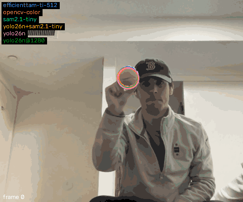

<div align="center">
<h1>Neuer</h1>
<p><b>A humanoid goalkeeper that sees shots with its own head camera and blocks them</b></p>

Felix Ogon · AMBER Lab, Caltech (Prof. Aaron D. Ames)
</div>

---

## Overview

Most humanoid ball experiments rely on an external **motion capture system** to tell the robot where the ball is. That works in a lab, but nowhere else.

**Neuer** is a goalkeeper for the Unitree G1 that does it alone: the robot **sees a shot coming with its own head camera**, predicts where the ball will cross the goal line, and moves to block it. No external sensors.

Blocking shots is the first step. Catching and throwing come next.

## Approach

```
Head RGB-D camera
      │
      ▼
1. Camera calibration ─── intrinsics + camera-to-head extrinsics (OpenCV)
      │
      ▼
2. Ball detection ─────── color thresholding → learned detector on NVIDIA Jetson
      │
      ▼
3. 3D tracking ────────── depth + head-motion compensation (robot head pose)
      │
      ▼
4. Shot prediction ────── Kalman filter → predicted crossing point and time
      │
      ▼
5. Save policy ────────── RL policy trained in MuJoCo (MJlab) → joint targets → save
```

1. **Calibration.** Estimate the camera intrinsics and the transform from the camera to the robot's head, so detections are expressed in the robot's frame.
2. **Detection.** Start with a fast color-based detector as a baseline, then move to a learned detector running on the onboard Jetson. The webcam benchmark (below) showed that a pretrained detector misses most hand-held balls, so it is fine-tuned on our own labelled frames before moving to the Jetson.
3. **3D tracking.** Use depth to place the ball in 3D, and compensate for the robot's own head motion so the estimate stays stable while it moves.
4. **Prediction.** A Kalman filter tracks the ball and predicts where and when it will reach the goal. This becomes the target for the save.
5. **Save policy.** Train the policy in simulation with realistic perception noise and latency, so it tolerates the imperfect estimates a real camera produces, then deploy it on hardware.

Background notes: [computer vision primer](docs/cv-primer.md).

## Results so far

Stage 1 compared four methods (two detectors, two trackers) on 21 hand-labelled webcam clips (distance, speed, lighting, occlusion, clutter, two balls).

<p align="center"></p>

| Method | Recall | Max reliable distance | Latency (median) | ≈ FPS |
|---|---|---|---|---|
| `opencv-color` | 92 % | ≥ 3.6 m | 2.3 ms | 439 |
| `yolo26n` | 39 % | 0.6 m | 11.9 ms | 84 |
| `efficienttam-ti-512` (GT prompt) | 100 % | ≥ 3.6 m | 101 ms | 10 |
| `sam2.1-tiny` (GT prompt) | 100 % | ≥ 3.6 m | 995 ms | 1 |
| `yolo26n+sam2.1-tiny` | 64 % | 0.6 m | 994 ms | 1 |

GT prompt = the tracker was given the ball's first labelled position (best case). `yolo26n+sam2.1-tiny` = the same tracker started from YOLO's first detection (realistic case).

- **Colour thresholding is the best real-time option** for a fluorescent ball, but it takes a second same-coloured ball for the target (17 false positives with two tennis balls in view).
- **Pretrained YOLO misses hand-held tennis balls even at a 0.01 confidence threshold** (≈ 65 % recall at best), so it needs fine-tuning on our own data.
- **Depth from apparent ball size has 15–19 cm of noise** (σ), so 3D tracking needs the RGB-D camera.

Full results: [perception/results/RESULTS.md](perception/results/RESULTS.md) · findings and protocol: [docs/perception-benchmark.md](docs/perception-benchmark.md)

## Hardware

The G1 needs a camera mount that stays stable during fast movements. I am designing a custom **head for the G1 in SolidWorks** with an integrated depth camera, using FEA to validate the parts.

## Evaluation

- **Metric:** save rate over repeated shots at increasing ball speeds.
- **Ground truth:** OptiTrack motion capture runs in parallel to measure perception error, but is never given to the policy.
- **Baseline:** the same policy driven by motion capture instead of the camera.

## Roadmap

**Blocking**
- [x] Perception benchmark on a webcam: OpenCV colour vs YOLO vs SAM 2 vs EfficientTAM across distance, speed, lighting, occlusion and clutter ([protocol](docs/perception-benchmark.md), [code](perception/), [results](perception/results/RESULTS.md))
- [x] Camera calibration pipeline (validated on the MacBook webcam, 0.17 px RMS)
- [ ] Head camera intrinsics + camera-to-head extrinsics
- [x] Color-based ball detection baseline (webcam)
- [ ] 3D tracking with head-motion compensation, validated against OptiTrack
- [ ] Kalman filter shot prediction
- [ ] Learned detector on Jetson
- [ ] Fine-tune YOLO on labelled frames (split by clip)
- [ ] Repeat key benchmark tests with a size-5 football
- [ ] Pick out the target ball among several (association in the Kalman filter)
- [ ] Save policy trained in simulation with perception noise and latency
- [ ] Custom camera head (SolidWorks, FEA)
- [ ] Hardware experiments on the G1

**Next**
- [ ] Catching the ball
- [ ] Throwing it back

## Acknowledgments

This project uses tools and methods from the AMBER Lab, including the humanoid training pipeline developed by Blake Werner and colleagues for [TaskNPoint](https://ilonadem.github.io/tasknpoint_website/).
