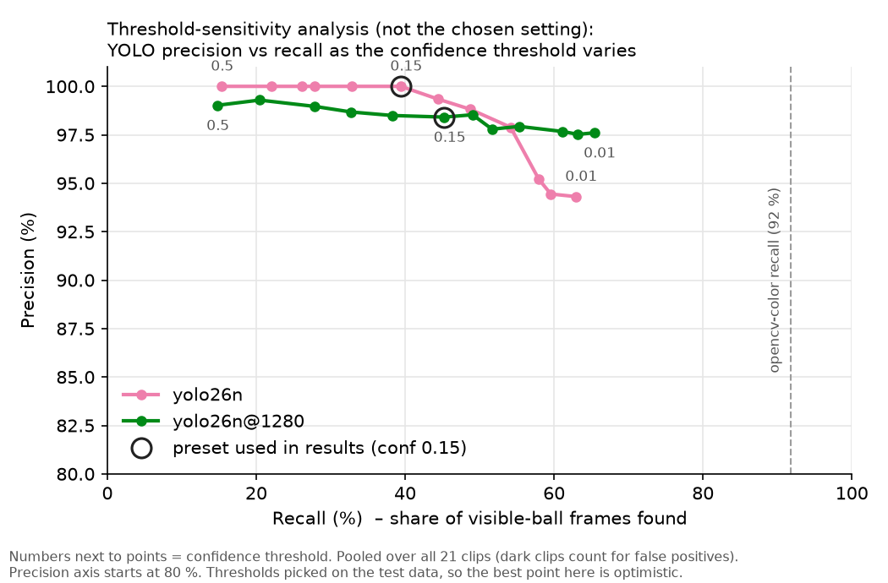

# Stage 1: Ball perception benchmark

**Question:** which ball detector should Neuer's perception stack be built on, and how good, how fast and how noisy is it?

**Why it matters for the whole project.** In the modular ("architecture") design, the save policy never sees images. It sees an interface state *z* (ball position, later velocity) produced by perception. The policy is trained in simulation, so it only survives on hardware if the simulator injects the *same* errors the real perception makes. This benchmark measures those errors: position noise, missed frames (dropouts), false detections and latency. Those numbers become the noise model for policy training, which answers the second "problem with architecture" on the whiteboard (*noise characterization of z*).

Code: [`perception/`](../perception). Results: [`perception/results/RESULTS.md`](../perception/results/RESULTS.md).

---

## Methods compared

| Method | Kind | What it needs | Why it is in the comparison |
|---|---|---|---|
| `opencv-color` | Classical: HSV threshold → contours → circle fit | Hand-tuned colour range | Baseline. ~1 ms, fully interpretable. Fails on colour changes and look-alikes. |
| `yolo26n` (and `yolo11n`) | Learned single-shot detector, COCO "sports ball" class | Nothing (pretrained) | Fast learned detector; the likely candidate for the Jetson. |
| `yolo26n@1280` | Same, larger input resolution | – | Tests the *small/far object* problem: does more input resolution recover far balls? |
| `sam2.1-tiny` | Promptable video segmentation with memory | A first-frame prompt | Strongest general segmenter/tracker; upper bound on mask quality. |
| `efficienttam-ti-512` | SAM 2 architecture with a light ViT encoder | A first-frame prompt | Meta's efficient SAM 2 variant; is it fast enough to matter? |
| `yolo26n+sam2.1-tiny` | Detect, then track | Nothing | Realistic version of the prompted trackers: YOLO provides the prompt. |

**Detectors vs prompted trackers.** YOLO and the colour method find the ball from scratch in every frame. SAM 2 and EfficientTAM *follow* an object someone pointed at. By default the benchmark prompts them with the first ground-truth box, which is their best case, and the `detector+tracker` rows show the realistic case. Keep this in mind when reading the table: the comparison is not quite like for like, and the table says so.

## Equipment

- MacBook Pro camera (1280×720 recording). Turn **Center Stage off** (Control Centre → Video Effects), otherwise the camera crops and zooms by itself and the intrinsics change while you record.
- Tennis ball (6.7 cm). Later: repeat the key tests with a real football (white/black panels; the colour baseline is expected to fail there).
- Tape measure and masking tape to mark distances on the floor.
- A checkerboard (`python scripts/make_checkerboard.py`, then print it or show it on an iPad) and a ruler.
- Something yellow or green as a distractor (highlighter, sticky notes, a shirt), a chair or box to hide the ball behind, and optionally a second ball.

## Procedure

Run everything from `perception/`. All tests are **hand-held**: the ball is held and moved by hand at roughly chest height, never thrown. Each clip is 6 s (`record.py` default, about 180 frames at 30 fps). Use the *same* HSV thresholds for every test: tune once in normal light, then leave them.

After every recording, check `data/clips/<name>/meta.json`: `n_frames` ≈ 180 and `fps` ≈ 30. Re-record if either is far off (dropped frames distort the timing and the speed estimate).

### T0. Calibration (once)

```
python scripts/make_checkerboard.py
python scripts/calibrate.py --square-mm <measured>
```
Collect 15–25 sharp views covering the whole image and tilted in all directions. Report the **RMS reprojection error** (target < 0.5 px), fx, fy and the horizontal FOV. Without this, pixels cannot be converted to metres (depth, 3D noise, speed in m/s).

Then tune the colour baseline once, in normal light: `python scripts/tune_color.py`, `s` to save. Never retune.

### Clip list

Every clip is recorded with `record.py --name <clip> --test <test> --pattern <pattern> ...`. `--pattern` (saved in `meta.json`) is how the ball moves; `summarize.py` groups and labels clips by it.

| Question | Clip | `--test` | `--pattern` | Other flags | What to do |
|---|---|---|---|---|---|
| What distance? | `dist_0.5m`, `dist_1m`, `dist_2m`, `dist_3m`, `dist_4m` (`dist_5m` if the room allows) | `distance` | `still` | `--distance <m>` | Hold the ball as still as you can at the taped distance |
| How fast? | `motion_lr_slow`, `motion_lr_fast` | `motion` | `left-right` | `--motion slow/fast --distance 1.5` | Sweep across the whole image and back |
| | `motion_ud_slow`, `motion_ud_fast` | `motion` | `up-down` | `--motion slow/fast --distance 1.5` | Sweep from waist to above the head and back |
| | `motion_circles` | `motion` | `circles` | `--distance 1.5` | Circles about 50 cm across |
| | `motion_toward_away` | `motion` | `toward-away` | `--distance 3` | Walk 3 m → 0.5 m → 3 m holding the ball in front of you |
| | `motion_shake` | `motion` | `shake` | `--motion fast --distance 1.5` | Shake the ball in place, as fast as you can |
| | `motion_out_and_back` | `motion` | `out-and-back` | `--distance 1.5` | Move out of the frame sideways, wait ~1 s, come back |
| In the dark? | `light_dim_lr`, `light_dark_lr` | `lighting` | `left-right` | `--lighting dim/dark --motion slow --distance 1.5` | Same as `motion_lr_slow`, one lamp / lights off (screen glow only) |
| | `light_dark_still` | `lighting` | `still` | `--lighting dark --distance 1.5` | Hold still, lights off |
| Occluded? | `occ_fingers_50` | `occlusion` | `still` | `--occlusion 50 --distance 1.5` | Fingers cover about half the ball |
| | `occ_behind_object` | `occlusion` | `behind-object` | `--occlusion passes-behind --distance 1.5` | Move the ball behind a chair/box, pause, come out |
| Clutter | `clutter_lr` | `clutter` | `left-right` | `--clutter "<objects>" --motion slow --distance 1.5` | Slow sweep in front of yellow/green objects |
| How many? | `multi_2balls` | `multi` | `left-right` | `--n-balls 2 --motion slow --distance 1.5` | One ball per hand, both sweeping; label the right-hand ball |

What each group measures:

- **Distance:** recall vs distance (→ **maximum reliable distance**, the farthest distance with ≥ 90 % recall), and depth error vs the tape measure from Z = fx·D / 2r. Expect depth error to grow with distance, because 1 px of radius error is a larger fraction of a small ball.
- **Motion:** the summary reports the ball's **speed in m/s** from the labels: pixel displacement between labelled frames × (Z / fx) / Δt, with Z from the ball's apparent size. This is lateral speed only; motion toward or away from the camera is ignored, so `toward-away` reads low. Watch for motion blur in `shake` and the fast clips: the ball smears, its colour mixes with the background and its apparent radius grows. A hand moves the ball at roughly 0.5–3 m/s, far below a kick (~20 m/s); see the limits below.
- **Lighting:** the summary logs mean image brightness (V), so lighting is a number and not just a word. The webcam's auto-exposure lengthens the exposure in the dark, which means more motion blur: a real effect worth noting.
- **Occlusion:** in the labeller, mark partly hidden frames with `o` and fully hidden frames with `n`. Key metric for `behind-object` and `out-and-back`: **max miss streak** (does the method re-acquire the ball after it reappears?).
- **Clutter:** **false positives**. The colour method should suffer here; the learned methods should not. The hand itself is also a distractor in every clip.
- **Multiple balls:** detections per frame. Prompted trackers follow only the prompted ball, which is the desired behaviour for a keeper.

### Labelling and running

```
python scripts/label.py data/clips/<clip> --every 5   # ~36 frames per clip
python scripts/benchmark.py                           # all clips x all methods
python scripts/summarize.py                           # tables + plots -> results/RESULTS.md
python scripts/render.py data/clips/<clip>            # overlay video, to see *why* methods fail
```

Budget: ~45 min recording (20 clips), ~1.5 h labelling, benchmark runtime depends on the SAM-family models (minutes per clip on MPS).

## Metrics

| Metric | Meaning | Why the keeper cares |
|---|---|---|
| Recall | % of frames with a visible ball where the method found it (within 1 radius) | Missed frames = dropouts the filter must bridge |
| Precision / false positives | % of reported balls that were real | A false ball can trigger a dive to nowhere |
| Centre error (px) | Distance from the labelled centre, on hits | Position noise on *z* |
| Depth error (%) | Distance from the ball's apparent size vs truth | Monocular depth noise; motivates RGB-D |
| Dropout | 1 − recall | The fraction of frames the Kalman filter must bridge; perception noise for policy training |
| 3D position noise σ (m) | Per-axis std of (back-projected prediction − back-projected label), on hits | The Kalman filter's measurement noise R |
| Max miss streak | Longest run of consecutive misses | Track loss; long gaps break prediction |
| Ball speed (m/s) | Lateral speed from the labels (clip property, not a method score) | Puts "fast" on a physical scale |
| Latency median / p95 | Compute time per frame | Every 10 ms of delay = 20 cm of ball travel at 20 m/s |

**Timing sanity check.** A penalty kick at ~20 m/s covers 11 m in ~0.55 s. At 30 fps that is ~16 frames, with the ball moving ~67 cm between frames. A method with 200 ms latency is reacting to where the ball was 4 m ago. This is why latency gets as much weight as accuracy, and why the final system needs a higher-frame-rate camera than a webcam.

## Results table (filled by `summarize.py`)

`results/RESULTS.md` contains, one row per method:

- **Summary:** recall, dropout, precision, centre error (px), 3D position noise σ (m), max distance with ≥ 90 % recall, recall on fast motion / shake / dark+dim / occlusion, max miss streak on out-and-back + behind-object, false positives in clutter, latency median / p95, ≈ FPS.
- **Noise model:** σX, σY, σZ and 3D σ in metres (all clips, and moving clips only), dropout, latency. These feed the Kalman filter and the policy-training noise model.
- **By pattern:** recall per hand-held pattern, with the measured median speed.
- **By test:** one table per test (rows = clips, columns = methods), plus `recall_vs_distance.png` and `latency.png`.

The findings below are written from those tables.

## Findings (hand-held webcam run, 26 Nov 2026)

**Setup.** MacBook Pro (M1 Pro) camera, 1280×720 at 30 fps, calibrated (RMS reprojection error 0.17 px, fx = 951 px). Tennis ball held and moved by hand, 21 clips of ~6 s, 784 hand-labelled frames (every 5th frame). Still clips at 0.6–3.6 m; all moving clips at ~1.2 m. Full tables: [`perception/results/RESULTS.md`](../perception/results/RESULTS.md).

### Summary table

Recall = % of frames with a visible ball where the method put its best guess within one ball radius of the label. Dropout = 1 − recall.

| Method | Recall (all) | Max reliable distance | Fast sweeps (p90 ≈ 2.5–3 m/s) | Shake | Half covered by fingers | Behind object / out of frame (max miss streak) | Two balls: recall · false pos. | Lights off: false pos. | Latency median / p95 | ≈ FPS |
|---|---|---|---|---|---|---|---|---|---|---|
| `opencv-color` | 92 % | ≥ 3.6 m | 100 % | 100 % | **0 %** | 100 % / 91 % (2) | 54 % · **17** | 0 | **2.3 / 2.7 ms** | 439 |
| `yolo26n` | 39 % | 0.6 m | 49 % | 33 % | 0 % | 44 % / 36 % (6) | 73 % · 0 | 0 | 11.9 / 16.3 ms | 84 |
| `yolo26n@1280` | 45 % | 1.2 m | 49 % | 17 % | 0 % | 28 % / 32 % (12) | 35 % · 5 | 0 | 22.6 / 24.8 ms | 44 |
| `sam2.1-tiny` (GT prompt) | 100 % | ≥ 3.6 m | 100 % | 100 % | 100 % | 100 % / 100 % (0) | 100 % · 0 | n/a | 995 / 1005 ms | 1 |
| `efficienttam-ti-512` (GT prompt) | 100 % | ≥ 3.6 m | 100 % | 100 % | 100 % | 100 % / 100 % (0) | 100 % · 0 | n/a | 101 / 104 ms | 10 |
| `yolo26n+sam2.1-tiny` | 64 % | 0.6 m | 88 % | 100 % | 0 % | 84 % / 73 % (6) | 92 % · 0 | 0 | 994 / 1005 ms | 1 |

Max reliable distance = farthest still clip such that every clip up to it has ≥ 90 % recall (≥ 3.6 m = passed the farthest clip recorded). Miss streak is in labelled frames (×5 camera frames ≈ ×167 ms). GT prompt = the tracker was given the first labelled box (best case). "n/a" in the dark = a GT-prompted tracker cannot start when the ball is never visible.

### Answers to the five questions

- **What distance?** Colour, SAM 2 and EfficientTAM found the ball in every frame of every still clip up to 3.6 m, the farthest recorded (ball radius ≈ 9 px there), so their true limit is beyond what was tested. Pretrained YOLO is not distance-limited but **confidence-limited**: its "sports ball" score for a hand-held tennis ball is 0.09–0.39, right around the 0.15 threshold, so it finds the ball in a whole clip or in none of it (yolo26n: 97 % at 0.6 m, 0 % at 1.2 and 1.8 m, 95 % at 2.4 m). Going to imgsz 1280 shifts which clips pass but does not fix this.
- **How fast?** Measured lateral ball speeds (from the labels, Z from the ball's apparent size): slow sweeps ~0.3–0.5 m/s, circles ~0.8 m/s, fast sweeps in bursts with p90 ≈ 2.4–3.1 m/s and peaks ≈ 4.5 m/s, shake ~2 m/s median / 3.4 m/s p90 (from the 30 fps colour track; the every-5th-frame labels alias the shake and read 3× low). Within that range **speed did not cost colour or the trackers any recall**. YOLO's recall stays at 30–80 % regardless of speed. Speed shows up as **noise**, not misses: motion blur inflates every method's radius (see below).
- **How many?** With two tennis balls (one per hand, labelled: right hand), colour picks whichever blob scores highest and jumps between the balls (recall 54 %, 17 false positives in 37 frames). YOLO@1280 also switches sometimes (5 FP). The prompted trackers stay on the ball they were given (100 %, 1.0 detection per frame), which is what a keeper needs, but only because they were told which ball to follow.
- **In the dark?** With the lights off **the webcam itself cannot see the ball**: mean image brightness is 1.3 / 255 and the ball was labelled "not visible" in every frame of `dark_lr` and `dark_still`. So no method can be evaluated there. What can be measured: **no method reported a ball that is not there** (0 false positives for colour, both YOLOs and YOLO+SAM 2; the GT-prompted trackers cannot start). The "dim" clip did not test low light either: auto-exposure made it *brighter* than the normal-light clips (V = 170 vs 137–164), and no method did worse than in normal light.
- **Occluded?** Two very different cases.
  - *Fingers covering half the ball:* colour **0 %** (the visible half-disc fills only ~33 % of its enclosing circle, below the 0.45 roundness filter, so the blob is rejected), all YOLO variants 0 %. SAM 2 and EfficientTAM 100 %, and their masks recover the full ball size (r = 26.7 px vs 26.5 px expected from the tape measure).
  - *Ball behind a tablet / out of the frame and back:* colour re-acquires as soon as the whole ball is back in view; its only misses (2 labelled frames) are the moments the ball is half-hidden on its way out and back in, the same partial-occlusion weakness as above. The trackers re-acquire with no missed frame and report nothing while the ball is hidden (no false positives). YOLO keeps missing as usual (miss streaks 6–12 labelled frames ≈ 1–2 s).

### Which method wins on what

- **Speed and simplicity: `opencv-color`.** 2.3 ms per frame (p95 2.7 ms), 100 % recall on every moving, distance and dim clip, lowest position noise. Breaks on partial occlusion by the hand and on a second ball of the same colour; will not work on a white/black football.
- **Robustness: SAM 2.1-tiny and EfficientTAM-Ti/512** (with a ground-truth first box). 100 % on every clip with a visible ball, including fingers and two balls. EfficientTAM matches SAM 2's accuracy at **10× less compute** (101 vs 995 ms per frame on MPS), which is exactly the paper's claim. Neither runs at camera rate on this laptop.
- **Pretrained YOLO: not usable as is.** 39–45 % recall overall, because COCO "sports ball" is unsure about a tennis ball in a hand. Its only role here is as the prompt for a tracker, and **the realistic detect-then-track pipeline (`yolo26n+sam2.1-tiny`) is only as good as that prompt**: 64 % overall, and 0 % on four of the six still clips where YOLO never fired. A lower threshold does not rescue it (next section); fine-tuning does (see *Next steps*).

### YOLO threshold-sensitivity analysis (not the chosen setting)

Because YOLO's scores sit near its 0.15 threshold, both YOLO variants were re-run at 0.01 into a separate folder and re-scored as if the threshold were 0.01…0.5, pooled over all 21 clips (dark clips included, so false positives count). The main results above keep the preset 0.15; this only shows how sensitive they are to that choice. The thresholds are judged on the test clips themselves, so the best point here is optimistic.



| Threshold | `yolo26n` recall · precision | `yolo26n@1280` recall · precision |
|---|---|---|
| 0.5 | 15 % · 100 % | 15 % · 99 % |
| **0.15 (preset)** | **39 % · 100 %** | **45 % · 98 %** |
| 0.05 | 54 % · 98 % | 55 % · 98 % |
| 0.01 | 63 % · 94 % | 65 % · 98 % |

- **Even at 0.01 YOLO finds only ~two thirds of the visible-ball frames**, against 92 % for colour at its fixed setting. On many frames COCO's "sports ball" head gives the held tennis ball no box at all, so the miss is not a threshold choice.
- Precision stays high (≥ 94 %). The extra false positives at 0.01 come mostly from `clutter_lr` (19 for `yolo26n`: the yellow objects start to count as balls), then `two_balls` (4 / 7) and `toward_away` (3). Still **none in the dark clips**.
- At 0.01 the distance results become less erratic (`yolo26n`: 97 % at 1.8 m instead of 0 %) but still fail at 1.2 m and 3.6 m, so the max reliable distance stays at 0.6 m.
- Details and per-clip false positives: [`perception/results/threshold_sweep/`](../perception/results/threshold_sweep/README.md).

### Failure modes seen in the overlay videos

GIFs: `perception/results/videos/{shake,lr_fast,behind_object,clutter_lr,two_balls}.gif`, rendered with `scripts/render.py <clip> --gif --crop` (cropped to the ball's region, 480 px wide, 15 fps, each under ~1 MB). White dashed circle = label; coloured circles = methods.

- **Blur when shaking / fast sweeps.** The ball smears into an ellipse along the motion. Nobody loses it at these speeds, but every method's circle grows with the smear (SAM 2's median radius in `shake` is 31.7 px vs 26.5 px for the real ball), so monocular depth reads the ball as too close. This is the largest source of σZ on moving clips.
- **The hand.** Contrary to expectation, **no method ever reported the hand as the ball**: the only false positives in the whole benchmark are on the *second ball* in `two_balls`. The hand matters in two other ways: it hides half the ball in `fingers_half` (fatal for colour), and it makes the held ball look less like a COCO "sports ball" to YOLO. The SAM-family masks also spill ~2 px past the ball's edge, which barely matters up close but biases depth by up to −0.6 m at 3.6 m (masks too big → ball too close). Colour and YOLO have no such trend.
- **Re-acquiring after leaving the frame.** Per-frame detectors (colour, YOLO) need no re-acquisition logic: they find the ball again when it is detectable. The trackers kept their memory across absences of ~1–1.5 s (twice per clip, out of frame or behind the tablet) and picked the same ball up again without a false detection while it was gone. Colour's 2 missed frames in `out_and_back` are the instants the ball is half-hidden while leaving and returning (labelled occluded).
- **Same-colour distractors: the colour method's main weakness.** The evidence is `two_balls`: with a second tennis ball in view, colour reported **17 false positives** in 37 labelled frames (recall 54 %), jumping to whichever ball's blob scored higher in that frame. It has no notion of *which* ball. The `clutter_lr` clip does not show this: its distractors (a yellow box of bin bags and a lemon-yellow object) are more orange than optic yellow and fall outside colour's tuned hue band, so colour reported 0 false positives there. Anything of the ball's own colour will fool it as `two_balls` does.
- **Auto-exposure in the "dim" clip.** The webcam compensated for the dimmed room: `dim_lr` came out *brighter* than the normal-light clips (mean V = 170 vs 137–164), so it did not test low light and no method did worse on it. Real low-light behaviour lies somewhere between this clip and the dark clips, where the camera sees nothing.

### Noise, dropout and latency in metres and milliseconds

3D error = back-projected prediction − back-projected label (each at the depth implied by its own radius, Z = fx · D / 2r), per-axis standard deviation over all hits. Frames labelled occluded are excluded: their label is the estimated full ball, but a method only sees the visible part, so its predicted radius, and therefore its depth, is biased. They still count for recall.

| Method | σX (m) | σY (m) | σZ (m) | Z bias, still ≥ 2.4 m (m) | σ 3D, moving clips (m) | Dropout, all / moving | Latency median / p95 (ms) |
|---|---|---|---|---|---|---|---|
| `opencv-color` | 0.014 | 0.017 | 0.147 | −0.03 | 0.173 | 8 % / 1 % | 2.3 / 2.7 |
| `yolo26n` | 0.020 | 0.028 | 0.125 | −0.18 | 0.155 | 61 % / 50 % | 11.9 / 16.3 |
| `yolo26n@1280` | 0.020 | 0.031 | 0.147 | −0.01 | 0.175 | 55 % / 56 % | 22.6 / 24.8 |
| `sam2.1-tiny` (GT prompt) | 0.021 | 0.029 | 0.183 | −0.44 | 0.181 | 0 % / 0 % | 995 / 1005 |
| `efficienttam-ti-512` (GT prompt) | 0.022 | 0.029 | 0.193 | −0.47 | 0.191 | 0 % / 0 % | 101 / 104 |
| `yolo26n+sam2.1-tiny` | 0.025 | 0.031 | 0.154 | −0.33 | 0.177 | 36 % / 11 % | 994 / 1005 |

How to read it:

- **Lateral (X, Y) noise is 1.5–3 cm** for every method at ~1.2 m: the image position of the ball is well measured.
- **Depth (Z) noise is ~15–19 cm**, about 10× worse, because monocular depth comes from a radius of ~10–25 px and 1 px of radius is 4–10 % of depth. It is worst on moving clips (blur). Part of it is label noise: on blurred frames the hand-clicked radius runs 2–4 px smaller than every method's. Treat σZ as an upper bound, and as the strongest argument for the G1's RGB-D camera.
- YOLO's slightly lower σ is a selection effect: it only scores on the frames where it is confident.
- **Dropout** for colour is 1 % on moving clips; its 8 % overall comes almost entirely from `fingers_half` (100 % missed). Missed frames are not spread evenly: they come in runs (occlusion, frame edge), which is what the simulator's perception-noise model should reproduce.

### Could one of these replace OptiTrack as the Kalman filter input (TaskNPoint, Section 6)?

In TaskNPoint, Section 6, the ball pipeline is **OptiTrack → Kalman filter (position + velocity) → ballistic + bounce model → action selection**, with OptiTrack running at 120 Hz (Appendix D.1). The paper attributes most of its hardware failures to imprecise ball-trajectory estimates, so the quality of the filter's input is what decides whether a save works. The question is whether a camera method could take OptiTrack's place at the start of that chain.

**For the tennis ball on this webcam: `opencv-color` is the only candidate, and only for lateral position.**

- **Rate.** Mocap delivers 120 Hz; the webcam delivers 30 Hz, so the filter gets 4× fewer updates (one every 33 ms instead of 8 ms). Only colour (2.3 ms) and YOLO (12–23 ms) fit inside one 33 ms frame. EfficientTAM caps out at ~10 Hz and SAM 2 at ~1 Hz on this laptop, so they would starve the filter.
- **Noise.** Measurement noise for colour, R ≈ diag(0.014², 0.017², 0.15²) m², against mocap's (typically) sub-millimetre accuracy: 1–2 orders of magnitude worse laterally and ~2–3 orders worse in depth. Differentiating 30 Hz positions, one frame of depth noise is a velocity error of √2 · 0.15 m / 0.033 s ≈ 6 m/s along the camera axis, which is the axis a shot travels along. **A monocular colour detector cannot give the filter a usable approach velocity; that needs the depth camera.**
- **Latency.** Compute is negligible for colour (2.3 ms) next to the 33 ms frame interval, but the frame interval itself matters: at 20 m/s the ball moves 0.67 m between webcam frames, against 0.17 m between mocap frames.
- **Dropout.** Colour's 1 % on moving clips is easily bridged by the filter's prediction step; its failure modes are runs, not single frames (a hand over the ball, a second yellow object, leaving the frame), and those need gating in the filter.

So: colour can stand in for OptiTrack for bench tests of the filter's *lateral* tracking with a tennis ball, at 30 Hz and with R from the table above. It cannot replace mocap as ground truth, and it cannot provide depth or approach velocity. The longer-term candidate is a detect-then-track pipeline with a fine-tuned detector and EfficientTAM on the Jetson, which this benchmark shows is accurate but needs ~10× more speed.

### Next steps

1. **Fine-tune YOLO on our own labels.** The ~800 hand-labelled frames from this run are a ready training set. Split **by clip**, not by frame (frames from the same clip are near-duplicates, so a frame split would leak test data into training): e.g. train on most clips, hold out one clip per condition (one distance, one fast motion, the occlusion and two-ball clips). This targets the main gap measured here: the pretrained detector's 39–45 % recall, and with it the 64 % of the realistic detect-then-track pipeline.
2. **A depth camera for Z.** Monocular depth from apparent size has σZ ≈ 15–19 cm and a distance-dependent bias, which makes approach velocity unusable (≈ 6 m/s error per frame difference). The G1's RGB-D camera (or a stereo pair) should measure Z directly; the image methods keep doing X/Y, where they are already at 1.5–3 cm.
3. **EfficientTAM at ~10 Hz correcting a fast detector.** Run a fast per-frame detector (fine-tuned YOLO or colour) at camera rate for the Kalman filter's updates, and EfficientTAM at ~10 Hz in parallel as a tracker that re-prompts from, and corrects, the detector: it keeps identity with two balls, survives the hand covering half the ball and re-acquires after the ball leaves the frame, which are exactly the cases where the detectors failed here.

### Limits of these findings

- **Webcam, not the robot camera.** 30 fps, rolling shutter, auto-exposure (which is why "dim" was not dim), no depth. Latencies are from an M1 Pro on MPS, not the Jetson.
- **Tennis ball, not a football.** The colour method is flattered by a fluorescent ball; on a white/black football it is expected to fail. Repeat the key clips with a football.
- **Hand-held, not kicked.** Ball speeds were ≤ ~4.5 m/s, far below a shot (~20 m/s), and a hand was always attached to the ball. Blur and missed frames will be much worse at real speeds.
- **SAM-family models got a ground-truth first prompt.** Their 100 % rows are an upper bound. The realistic version (`yolo26n+sam2.1-tiny`, prompted by YOLO) scored 64 %, limited by the pretrained detector. The prompt frame itself is also scored (1 of ~36 labelled frames per clip).
- **Labels are human clicks every 5th frame.** About 1–2 px of label noise on centre and radius; more on blurred frames (radius 2–4 px smaller than all methods). Speeds are sampled every 167 ms, so oscillations are under-measured. Frames labelled occluded (`fingers_half`, and the half-hidden frames in `out_and_back` / `behind_object`) are excluded from the depth/noise statistics: the label there is the estimated full ball, while a method only sees the visible part, so its predicted radius is biased small.
- **Small sample.** One clip per condition, one person, one room. The motion clips were at ~1.2 m (not 1.5 m). The clutter objects did not match the ball's hue (the same-colour case is covered by `two_balls`), and auto-exposure undid the dim setting.


## Limits of this benchmark (say these out loud when presenting)

- **Webcam ≠ robot camera.** 30 fps, rolling shutter, auto-exposure, no depth. Absolute numbers will not transfer; the *ranking* and the *failure modes* should.
- **Laptop ≠ Jetson.** Latency is measured on Apple Silicon (MPS). Relative speeds transfer roughly; the Jetson needs its own timing run (TensorRT export for YOLO).
- **Tennis ball ≠ football.** The colour baseline is flattered by a fluorescent ball.
- **Hand-held ≠ kicked.** The ball is moved by hand at a few m/s, an order of magnitude slower than a shot, and a hand is always attached to it.
- **Labels are human clicks.** Expect ~1–2 px of label noise on centre and radius. Do not read differences below that.
- **Prompted trackers get help.** GT-prompted rows are an upper bound.

## Reading list

The whiteboard asks to understand **architecture, data and loss** for each model. For each paper, write half a page in `docs/reading-notes/`:

1. *Architecture*: what goes in, what comes out, what are the main blocks?
2. *Data*: what was it trained on, how was that data labelled, would a tennis ball or football be in it?
3. *Loss*: what is being minimised, and what does that reward or ignore? (e.g. does a box loss care about a 5-pixel object?)
4. *For Neuer*: which of our tests do you expect it to pass or fail, and why? Then check against the results.

| Paper | Read for |
|---|---|
| Ravi et al., *SAM 2: Segment Anything in Images and Videos*, 2024 ([arXiv:2408.00714](https://arxiv.org/abs/2408.00714)) | Memory attention, the streaming design, the SA-V data engine, the occlusion head |
| Xiong et al., *Efficient Track Anything*, ICCV 2025 ([arXiv:2411.18933](https://arxiv.org/abs/2411.18933)) | Which parts of SAM 2 are expensive and how they were made cheap |
| Redmon et al., *You Only Look Once*, 2016 ([arXiv:1506.02640](https://arxiv.org/abs/1506.02640)) | The original single-shot idea; read before the modern version |
| Jocher et al., *Ultralytics YOLO26*, 2026 ([arXiv:2606.03748](https://arxiv.org/abs/2606.03748)) | NMS-free end-to-end detection, small-object changes, edge deployment |
| Zhang, *A Flexible New Technique for Camera Calibration*, IEEE TPAMI 2000 | What `calibrate.py` actually solves |
| OpenCV tutorials: *Camera Calibration*, *Changing Colorspaces*, *Contours* | The colour baseline, step by step |
