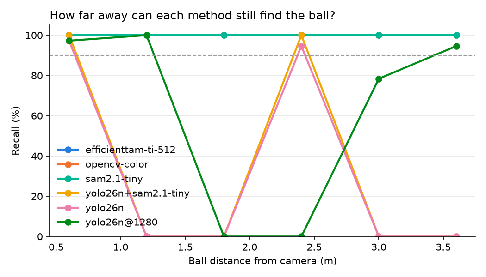
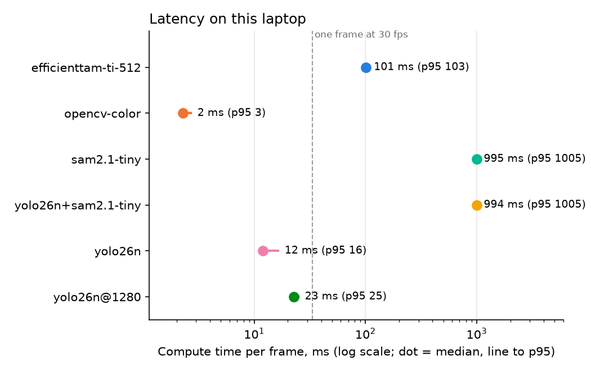

# Ball perception benchmark: results

*Generated by `scripts/summarize.py` on 2026-11-26.*

**Setup.** Apple M1 Pro · camera 1280×720 @ ~30.01 fps (calibrated, reprojection RMS 0.17 px, fx = 951 px) ·
21 clips · 784 hand-labelled frames · ball: tennis.
SAM 2 / EfficientTAM rows prompted with the first ground-truth box unless the name says `detector+tracker`.
Protocol: [`docs/perception-benchmark.md`](../../docs/perception-benchmark.md).

## Summary

| Method                | Recall (all)   | Dropout   | Precision (all)   |   Centre err (px) |   Pos. noise σ (m) | Max dist ≥90% recall   | Recall: fast   | Recall: shake   | Recall: dim   | False pos. (dark, no ball visible)   | Recall: occluded   |   Max miss streak: out/behind |   False pos. (clutter) | Latency median / p95 (ms)   |   ≈ FPS |
|:----------------------|:---------------|:----------|:------------------|------------------:|-------------------:|:-----------------------|:---------------|:----------------|:--------------|:-------------------------------------|:-------------------|------------------------------:|-----------------------:|:----------------------------|--------:|
| `efficienttam-ti-512` | 100%           | 0%        | 100%              |               3   |              0.196 | 3.6 m                  | 100%           | 100%            | 100%          | n/a                                  | 100%               |                             0 |                      0 | 101.0 / 103.5               |      10 |
| `opencv-color`        | 92%            | 8%        | 97%               |               2.6 |              0.148 | 3.6 m                  | 100%           | 100%            | 100%          | 0                                    | 50%                |                             2 |                      0 | 2.3 / 2.7                   |     439 |
| `sam2.1-tiny`         | 100%           | 0%        | 100%              |               2.5 |              0.187 | 3.6 m                  | 100%           | 100%            | 100%          | n/a                                  | 100%               |                             0 |                      0 | 994.9 / 1004.9              |       1 |
| `yolo26n+sam2.1-tiny` | 64%            | 36%       | 100%              |               2.9 |              0.159 | 0.6 m                  | 88%            | 100%            | 83%           | 0                                    | 42%                |                             6 |                      0 | 994.3 / 1004.6              |       1 |
| `yolo26n`             | 39%            | 61%       | 100%              |               2.9 |              0.13  | 0.6 m                  | 49%            | 33%             | 39%           | 0                                    | 22%                |                             6 |                      0 | 11.9 / 16.3                 |      84 |
| `yolo26n@1280`        | 45%            | 55%       | 98%               |               2.7 |              0.151 | 1.2 m                  | 49%            | 17%             | 64%           | 0                                    | 14%                |                            12 |                      0 | 22.6 / 24.8                 |      44 |

Dropout = 1 − recall. Recall, dropout and precision are means over clips (each condition counts equally).
Max dist ≥90% recall = farthest distance with ≥ 90 % recall *at every distance up to it*.
Pos. noise σ = √(σX² + σY² + σZ²) of the 3D error on hits, pooled over all clips (see below).
Clips where the ball is never visible (lights off) are left out of recall, dropout and precision and scored by false positives only;
the GT-prompted trackers cannot run on them at all (n/a: there is no visible ball to prompt with).
Max miss streak is counted in labelled frames (×5 camera frames when labelled with `--every 5`).

*At 100 % at every distance (lines drawn on top of each other): `efficienttam-ti-512`, `opencv-color`, `sam2.1-tiny`.*

## Noise model (for the Kalman filter and policy training)

| Method                |   Hits |   σX (m) |   σY (m) |   σZ (m) |   Z bias (m) |   Z bias, still ≥ 2.4 m (m) |   σ 3D, all clips (m) |   σ 3D, moving clips (m) | Dropout, all   | Dropout, moving   | Latency median / p95 (ms)   |
|:----------------------|-------:|---------:|---------:|---------:|-------------:|----------------------------:|----------------------:|-------------------------:|:---------------|:------------------|:----------------------------|
| `efficienttam-ti-512` |    685 |    0.022 |    0.029 |    0.193 |       -0.236 |                      -0.472 |                 0.196 |                    0.191 | 0%             | 0%                | 101.0 / 103.5               |
| `opencv-color`        |    629 |    0.014 |    0.017 |    0.147 |       -0.05  |                      -0.028 |                 0.148 |                    0.173 | 8%             | 1%                | 2.3 / 2.7                   |
| `sam2.1-tiny`         |    685 |    0.021 |    0.029 |    0.183 |       -0.226 |                      -0.435 |                 0.187 |                    0.181 | 0%             | 0%                | 994.9 / 1004.9              |
| `yolo26n+sam2.1-tiny` |    438 |    0.025 |    0.031 |    0.154 |       -0.225 |                      -0.328 |                 0.159 |                    0.177 | 36%            | 11%               | 994.3 / 1004.6              |
| `yolo26n`             |    270 |    0.02  |    0.028 |    0.125 |       -0.143 |                      -0.176 |                 0.13  |                    0.155 | 61%            | 50%               | 11.9 / 16.3                 |
| `yolo26n@1280`        |    310 |    0.02  |    0.031 |    0.147 |       -0.1   |                      -0.012 |                 0.151 |                    0.175 | 55%            | 56%               | 22.6 / 24.8                 |

3D error = back-projected prediction − back-projected hand label, in camera coordinates (X right, Y down, Z forward),
each point at the depth implied by its own radius (Z = fx · D / 2r). σ is the per-axis standard deviation over every hit.
The reference is a hand click, so ~1–2 px of label noise is included. Frames labelled occluded are excluded: the label is the
estimated full ball, but a method only sees the visible part, so its predicted radius (and depth) is biased. Z bias = mean Z error; negative = the method sees the ball too big, i.e. too close.
σZ comes mostly from the moving clips (motion blur changes the apparent radius, and blurred balls are harder to label) and,
for the SAM-family masks, from a radius bias that grows with distance.
Dropout is the fraction of visible frames with no hit (missed or wrong place): the frames the filter must bridge.

## By pattern

| Pattern       |   Clips | Median speed (m/s)   | `efficienttam-ti-512`   | `opencv-color`   | `sam2.1-tiny`   | `yolo26n+sam2.1-tiny`   | `yolo26n`   | `yolo26n@1280`   |
|:--------------|--------:|:---------------------|:------------------------|:-----------------|:----------------|:------------------------|:------------|:-----------------|
| still         |       8 | –                    | 100%                    | 86%              | 100%            | 29%                     | 27%         | 53%              |
| left-right    |       5 | 0.36                 | 100%                    | 100%             | 100%            | 77%                     | 28%         | 36%              |
| up-down       |       3 | 0.45                 | 100%                    | 85%              | 100%            | 94%                     | 73%         | 53%              |
| circles       |       1 | 0.82                 | 100%                    | 100%             | 100%            | 100%                    | 75%         | 67%              |
| toward-away   |       1 | 0.11                 | 100%                    | 100%             | 100%            | 78%                     | 39%         | 35%              |
| shake         |       1 | 0.60                 | 100%                    | 100%             | 100%            | 100%                    | 33%         | 17%              |
| out-and-back  |       1 | 0.21                 | 100%                    | 91%              | 100%            | 73%                     | 36%         | 32%              |
| behind-object |       1 | 0.15                 | 100%                    | 100%             | 100%            | 84%                     | 44%         | 28%              |

Cell = mean recall over the clips with that hand-held pattern.
Speed is lateral speed from the labels: pixel displacement × (Z / fx) / Δt, with Z from the ball's apparent size.
It ignores motion toward or away from the camera, so `toward-away` reads low.
Labels are every 5th frame (~167 ms), so fast oscillation is aliased: `shake` reads ~3× too low (a 30 fps colour track gives ~2 m/s median,
p90 ~3.4 m/s). Fast sweeps are short bursts between pauses, so their p90 (in the per-test tables) is the better "fast" number.

## By test

### Distance

Cell = recall · median centre error · false positives

| Clip       | Condition    | `efficienttam-ti-512`     | `opencv-color`            | `sam2.1-tiny`             | `yolo26n+sam2.1-tiny`     | `yolo26n`                | `yolo26n@1280`            |
|:-----------|:-------------|:--------------------------|:--------------------------|:--------------------------|:--------------------------|:-------------------------|:--------------------------|
| still_0.6m | 0.6 m, still | 100% · 5.7 px · σ 0.045 m | 100% · 3.3 px · σ 0.047 m | 100% · 4.8 px · σ 0.046 m | 100% · 4.8 px · σ 0.046 m | 97% · 5.4 px · σ 0.046 m | 97% · 4.7 px · σ 0.047 m  |
| still_1.2m | 1.2 m, still | 100% · 2.4 px · σ 0.015 m | 100% · 2.5 px · σ 0.025 m | 100% · 2.8 px · σ 0.023 m | 0% · – px                 | 0% · – px                | 100% · 2.4 px · σ 0.022 m |
| still_1.8m | 1.8 m, still | 100% · 3.0 px · σ 0.032 m | 100% · 6.1 px · σ 0.037 m | 100% · 3.1 px · σ 0.022 m | 0% · – px                 | 0% · – px                | 0% · – px                 |
| still_2.4m | 2.4 m, still | 100% · 0.8 px · σ 0.026 m | 100% · 1.1 px · σ 0.089 m | 100% · 1.3 px · σ 0.028 m | 100% · 0.9 px · σ 0.028 m | 95% · 0.8 px · σ 0.024 m | 0% · – px                 |
| still_3.0m | 3 m, still   | 100% · 1.3 px · σ 0.043 m | 100% · 3.7 px · σ 0.064 m | 100% · 0.7 px · σ 0.040 m | 0% · – px                 | 0% · – px                | 78% · 1.7 px · σ 0.053 m  |
| still_3.6m | 3.6 m, still | 100% · 1.1 px · σ 0.064 m | 100% · 1.4 px · σ 0.106 m | 100% · 1.3 px · σ 0.031 m | 0% · – px                 | 0% · – px                | 95% · 1.0 px · σ 0.088 m  |

### Motion

Cell = recall · median centre error · false positives

| Clip         | Condition                                        | `efficienttam-ti-512`         | `opencv-color`               | `sam2.1-tiny`                 | `yolo26n+sam2.1-tiny`        | `yolo26n`                    | `yolo26n@1280`               |
|:-------------|:-------------------------------------------------|:------------------------------|:-----------------------------|:------------------------------|:-----------------------------|:-----------------------------|:-----------------------------|
| lr_fast      | left-right fast, ~0.36 m/s (p90 2.43), 1.2 m     | 100% · 3.4 px                 | 100% · 2.7 px                | 100% · 2.8 px                 | 86% · 3.1 px                 | 32% · 3.4 px                 | 35% · 3.2 px                 |
| lr_slow      | left-right slow, ~0.32 m/s (p90 0.57), 1.2 m     | 100% · 3.1 px                 | 100% · 2.2 px                | 100% · 2.7 px                 | 86% · 3.4 px                 | 35% · 4.4 px                 | 41% · 4.3 px                 |
| ud_fast      | up-down fast, ~0.51 m/s (p90 2.81), 1.2 m        | 100% · 3.7 px                 | 100% · 3.6 px                | 100% · 3.2 px                 | 89% · 3.1 px                 | 65% · 2.1 px                 | 62% · 2.8 px                 |
| ud_slow      | up-down slow, ~0.45 m/s (p90 0.85), 1.2 m        | 100% · 3.1 px                 | 100% · 2.6 px                | 100% · 2.5 px                 | 100% · 2.6 px                | 81% · 2.4 px                 | 62% · 2.6 px                 |
| circles      | circles medium, ~0.82 m/s (p90 1.05), 1.2 m      | 100% · 3.5 px                 | 100% · 2.6 px                | 100% · 2.7 px                 | 100% · 2.9 px                | 75% · 2.7 px                 | 67% · 2.6 px                 |
| toward_away  | toward-away slow, ~0.11 m/s (p90 0.37)           | 100% · 1.9 px                 | 100% · 1.5 px                | 100% · 1.8 px                 | 78% · 2.1 px                 | 39% · 2.3 px                 | 35% · 2.0 px                 |
| shake        | shake fast, ~0.60 m/s (p90 1.11), 1.2 m          | 100% · 4.8 px                 | 100% · 4.0 px                | 100% · 4.7 px                 | 100% · 4.9 px                | 33% · 4.7 px                 | 17% · 5.0 px                 |
| out_and_back | out-and-back medium, ~0.21 m/s (p90 1.28), 1.2 m | 100% · 3.4 px · miss streak 0 | 91% · 2.0 px · miss streak 2 | 100% · 2.9 px · miss streak 0 | 73% · 3.5 px · miss streak 6 | 36% · 3.5 px · miss streak 6 | 32% · 4.1 px · miss streak 6 |

### Lighting

Cell = recall · median centre error · false positives

| Clip       | Condition                                            | `efficienttam-ti-512`   | `opencv-color`                                | `sam2.1-tiny`      | `yolo26n+sam2.1-tiny`                         | `yolo26n`                                     | `yolo26n@1280`                                |
|:-----------|:-----------------------------------------------------|:------------------------|:----------------------------------------------|:-------------------|:----------------------------------------------|:----------------------------------------------|:----------------------------------------------|
| dark_still | dark (V=1), still, 1.2 m                             | n/a (no GT prompt)      | 0 FP in 36 labelled frames (ball not visible) | n/a (no GT prompt) | 0 FP in 36 labelled frames (ball not visible) | 0 FP in 36 labelled frames (ball not visible) | 0 FP in 36 labelled frames (ball not visible) |
| dark_lr    | dark (V=1), left-right, 1.2 m                        | n/a (no GT prompt)      | 0 FP in 37 labelled frames (ball not visible) | n/a (no GT prompt) | 0 FP in 37 labelled frames (ball not visible) | 0 FP in 37 labelled frames (ball not visible) | 0 FP in 37 labelled frames (ball not visible) |
| dim_lr     | dim (V=170), left-right, ~0.42 m/s (p90 0.74), 1.2 m | 100% · 2.9 px           | 100% · 3.5 px                                 | 100% · 2.5 px      | 83% · 2.6 px                                  | 39% · 3.0 px                                  | 64% · 2.8 px                                  |

### Occlusion

Cell = recall · median centre error · false positives

| Clip          | Condition                                  | `efficienttam-ti-512`         | `opencv-color`                | `sam2.1-tiny`                 | `yolo26n+sam2.1-tiny`        | `yolo26n`                    | `yolo26n@1280`                |
|:--------------|:-------------------------------------------|:------------------------------|:------------------------------|:------------------------------|:-----------------------------|:-----------------------------|:------------------------------|
| fingers_half  | still, occlusion 50, 1.2 m                 | 100% · 3.5 px                 | 0% · – px                     | 100% · 2.5 px                 | 0% · – px                    | 0% · – px                    | 0% · – px                     |
| behind_object | behind-object, ~0.15 m/s (p90 0.52), 1.2 m | 100% · 2.7 px · miss streak 0 | 100% · 2.8 px · miss streak 0 | 100% · 2.4 px · miss streak 0 | 84% · 2.1 px · miss streak 4 | 44% · 1.8 px · miss streak 6 | 28% · 1.6 px · miss streak 12 |

### Clutter

Cell = recall · median centre error · false positives

| Clip       | Condition                                                                | `efficienttam-ti-512`   | `opencv-color`   | `sam2.1-tiny`   | `yolo26n+sam2.1-tiny`   | `yolo26n`   | `yolo26n@1280`   |
|:-----------|:-------------------------------------------------------------------------|:------------------------|:-----------------|:----------------|:------------------------|:------------|:-----------------|
| clutter_lr | left-right in front of yellow/green objects, ~0.35 m/s (p90 0.63), 1.2 m | 100% · 2.6 px           | 100% · 2.5 px    | 100% · 2.1 px   | 51% · 2.9 px            | 5% · 3.1 px | 5% · 2.6 px      |

### Multi

Cell = recall · median centre error · false positives

| Clip      | Condition                                     | `efficienttam-ti-512`          | `opencv-color`                        | `sam2.1-tiny`                  | `yolo26n+sam2.1-tiny`         | `yolo26n`                     | `yolo26n@1280`                       |
|:----------|:----------------------------------------------|:-------------------------------|:--------------------------------------|:-------------------------------|:------------------------------|:------------------------------|:-------------------------------------|
| two_balls | 2 balls, up-down, ~0.33 m/s (p90 0.60), 1.2 m | 100% · 2.7 px · 1.0 dets/frame | 54% · 1.9 px · 17 FP · 1.9 dets/frame | 100% · 2.4 px · 1.0 dets/frame | 92% · 2.6 px · 0.9 dets/frame | 73% · 2.3 px · 0.8 dets/frame | 35% · 2.8 px · 5 FP · 0.6 dets/frame |

