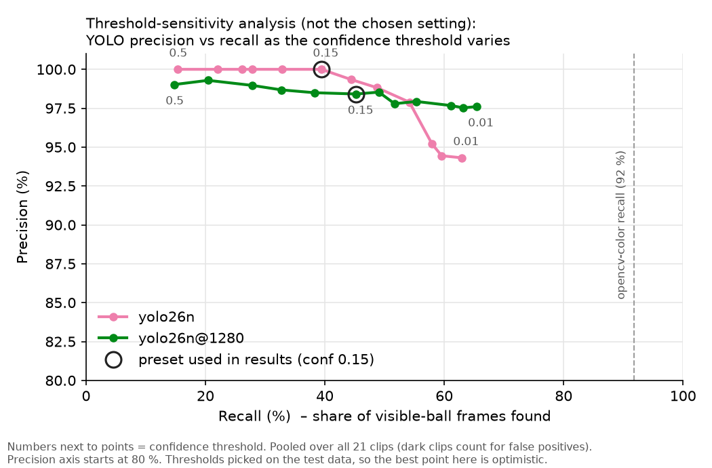

# YOLO threshold-sensitivity analysis

**Not the chosen setting.** The main results use the preset confidence threshold 0.15. Here YOLO was re-run at 0.01 (`raw/`) and re-scored as if the threshold were t, pooled over all clips with the same hit rule as `../RESULTS.md`. The thresholds are judged on the test clips themselves, so the best point is optimistic.

Made by `scripts/benchmark.py --methods yolo26n yolo26n@1280 --yolo-conf 0.01 --out results/threshold_sweep/raw` and `scripts/threshold_sweep.py`.

| method       |   threshold |   hits |   n_visible |   false pos. |   recall % |   precision % |
|:-------------|------------:|-------:|------------:|-------------:|-----------:|--------------:|
| yolo26n      |       0.01  |    431 |         685 |           26 |       62.9 |          94.3 |
| yolo26n      |       0.02  |    408 |         685 |           24 |       59.6 |          94.4 |
| yolo26n      |       0.03  |    397 |         685 |           20 |       58   |          95.2 |
| yolo26n      |       0.05  |    371 |         685 |            8 |       54.2 |          97.9 |
| yolo26n      |       0.075 |    334 |         685 |            4 |       48.8 |          98.8 |
| yolo26n      |       0.1   |    304 |         685 |            2 |       44.4 |          99.3 |
| yolo26n      |       0.15  |    270 |         685 |            0 |       39.4 |         100   |
| yolo26n      |       0.2   |    225 |         685 |            0 |       32.8 |         100   |
| yolo26n      |       0.25  |    191 |         685 |            0 |       27.9 |         100   |
| yolo26n      |       0.3   |    179 |         685 |            0 |       26.1 |         100   |
| yolo26n      |       0.4   |    151 |         685 |            0 |       22   |         100   |
| yolo26n      |       0.5   |    105 |         685 |            0 |       15.3 |         100   |
| yolo26n@1280 |       0.01  |    448 |         685 |           11 |       65.4 |          97.6 |
| yolo26n@1280 |       0.02  |    433 |         685 |           11 |       63.2 |          97.5 |
| yolo26n@1280 |       0.03  |    419 |         685 |           10 |       61.2 |          97.7 |
| yolo26n@1280 |       0.05  |    379 |         685 |            8 |       55.3 |          97.9 |
| yolo26n@1280 |       0.075 |    354 |         685 |            8 |       51.7 |          97.8 |
| yolo26n@1280 |       0.1   |    336 |         685 |            5 |       49.1 |          98.5 |
| yolo26n@1280 |       0.15  |    310 |         685 |            5 |       45.3 |          98.4 |
| yolo26n@1280 |       0.2   |    262 |         685 |            4 |       38.2 |          98.5 |
| yolo26n@1280 |       0.25  |    224 |         685 |            3 |       32.7 |          98.7 |
| yolo26n@1280 |       0.3   |    191 |         685 |            2 |       27.9 |          99   |
| yolo26n@1280 |       0.4   |    140 |         685 |            1 |       20.4 |          99.3 |
| yolo26n@1280 |       0.5   |    101 |         685 |            1 |       14.7 |          99   |

False positives at 0.01, by clip:

| method       | clip          |   false_pos |
|:-------------|:--------------|------------:|
| yolo26n@1280 | behind_object |           1 |
| yolo26n      | clutter_lr    |          19 |
| yolo26n@1280 | clutter_lr    |           3 |
| yolo26n      | toward_away   |           3 |
| yolo26n      | two_balls     |           4 |
| yolo26n@1280 | two_balls     |           7 |
